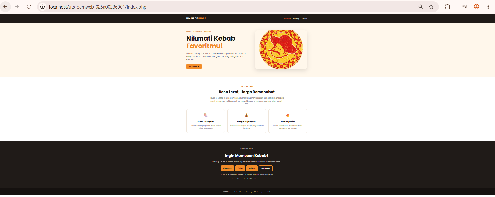
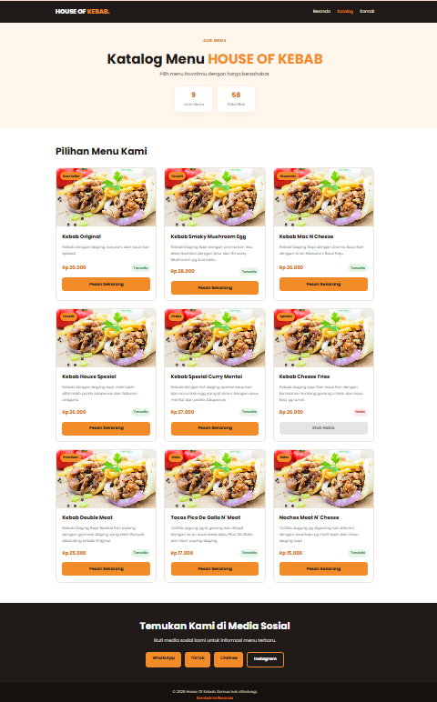

# House of Kebab — UTS Pemrograman Web

## Identitas
- **Nama:** Aldi Wahyu Permadi
- **NIM:** 025A00236001
- **Kelas:** 253A23W15 — Kelas Malam
- **Tema:** Katalog Usaha — House of Kebab

## Deskripsi
Website profil dan katalog menu untuk usaha House of Kebab. Data disimpan dalam array PHP dan ditampilkan secara dinamis menggunakan `foreach`.

## Cara Menjalankan
1. Simpan folder proyek di dalam folder `www` 
2. Jalankan layanan Apache
3. Buka alamat berikut di peramban:
   - `http://localhost/uts-pemweb-025A00236001/index.php` → Halaman Beranda
   - `http://localhost/uts-pemweb-025A00236001/katalog.php` → Halaman Katalog

## Tampilan Proyek
### Halaman Beranda

### Halaman Katalog

